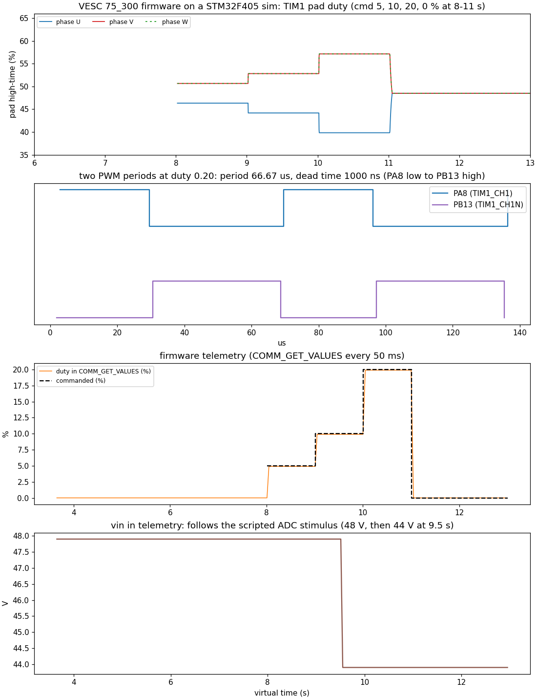

# VESC firmware

<!-- simantic-banner -->
> **Run this firmware with no hardware.** [Simantic](https://simantic.com) simulates the whole board, peripherals, sensors and buses included. Try it free at **[simantic.com](https://simantic.com)**, or run it locally: `curl -fsSL https://simantic.com/install | sh`

## This fork: the VESC firmware on a simulated STM32F405

Simantic's fork of vedderb/bldc. Upstream commit `cb79df89` (version 7.01 sources, hardware target `75_300`, Trampa VESC 75/300,
STM32F405RG) runs unmodified on a simulated F405. A scripted UART host speaks the VESC packet protocol on USART3 (`COMM_FW_VERSION`,
`COMM_GET_VALUES`, `COMM_SET_DUTY`) and the TIM1 gate-driver pads are recorded. No board, no motor. Everything is in [`sim/`](sim/).

```
cd sim && SIM=/path/to/sim ./run.sh     # needs the F405 timer/ADC trigger model (see "Needs a newer sim"); the plot needs python3 + matplotlib
```



**Measured, from a real run** ([`sim/run.log`](sim/run.log), [`sim/measured.txt`](sim/measured.txt); 13 s of virtual time):

- Build: `make fw_75_300 ARM_SDK_PREFIX=arm-none-eabi- ULIBS="-lm -u _printf_float"` with arm-none-eabi-gcc 15.2, no source change.
- `COMM_FW_VERSION` answers `7.01`, hardware name `75_300`. The firmware's motor init waits for the pack voltage to settle and
  calibrates the current offsets first, so the UART app answers from 3.65 s of virtual time.
- TIM1 as programmed (read back from the sim at 9.5 s): center-aligned, `PSC` 0, `ARR` 5600, `BDTR` 0xAC94. The pad edges give a period of
  66.67 us = 15.00 kHz on PA8/PA9/PA10 (2 x 5600 / 168 MHz, RM0090 center-aligned mode), 76188 cycles per phase.
- Dead time between PA8 low and PB13 (CH1N) high: 1000 ns, equal to `HW_DEAD_TIME_NSEC` (`DTG` 0x94: (64 + 20) x 2 x 5.95 ns, RM0090 BDTR).
- `COMM_SET_DUTY` 5, 10, 20 and 0 % at 8, 9, 10 and 11 s: the firmware's own telemetry reports duty 0.049, 0.099, 0.199, 0.000 (filtered).
  On the pads, phase V and W sit at 50.66 / 52.82 / 57.14 % high-time and phase U at 46.34 / 44.18 / 39.84 %. The V minus U difference is
  4.32 / 8.64 / 17.30 points, duty x sqrt(3)/2 (4.33 / 8.66 / 17.32) to 0.02 points; at 0 % all three phases sit at 48.50 %, which is 50 %
  minus the dead time (1.5 %). The common-mode offset is the firmware's SVPWM.
- `vin` in the telemetry follows the scripted ADC pack voltage: 47.9 V for 48.0 V, 43.9 V for 44.0 V (after the step at 9.5 s).
- No fault code in 187 `COMM_GET_VALUES` replies.

**Scripted, not modelled** (no motor, no battery, no physics plant; all of this is time-tabled stimulus):

- `adc_stim.py`: ADC channels of the 75_300 front end as constants: pack voltage 48 V, then 44 V from 9.5 s (IN13 through the 56k/2.2k
  divider); phase currents at the amplifier mid-scale (0 A); phase sense pins 0 V; NTCs 10k at 25 C.
- `tool.py`: the host. It polls `COMM_GET_VALUES` every 50 ms and sends `COMM_SET_DUTY` every 20 ms (inside the firmware's 1 s app timeout).
- `probe.py`: read-only, logs the TIM1 registers.

**What does not work / is not shown**

- **Needs a newer sim.** Released `sim` 0.10.4 does not convert the F405 ADC: TIM1's update event does not reset TIM2 (`TIM2.SMCR` = 0x4, ITR0,
  as the firmware sets it) so the TIM2 CC2 ADC trigger fires about once per 65536 ticks. On 0.10.4 the firmware reads `vin` 0.0 and a MOSFET temperature of -273 C (ADC code 0), waits its full 10 s calibration timeout, the UART app answers from 10.35 s, and the duty command never reaches the pads
  (reported duty 0.000, pads idle at 50 %). The numbers above come from a pre-release pyrite build (`sim 0.10.0`, commit `50d3404e`) that has the
  F405 timer-trigger / ADC-triple-mode work of [pyrite#3515](https://github.com/simantic-dev/pyrite/pull/3515). That PR was merged into a stacked
  branch, not `main`: [pyrite#3813](https://github.com/simantic-dev/pyrite/issues/3813).
- No motor and no encoder or hall input: `erpm` stays 0, phase currents stay 0, and `COMM_SET_DUTY` in FOC mode with no rotor shows only the
  voltage vector (duty x Vbus / sqrt(3)) at a fixed angle. Current control, the observer, start-up, regen and the fault paths are not exercised.
  The firmware's own FOC under a plant is in the sim-fixtures `ebike-vesc` fixtures.
- Default motor configuration (`MCCONF` defaults, FOC): no `COMM_SET_MCCONF` is sent.
- Only hardware `75_300` is run. CAN, USB, LispBM, the IMU and BLE are not wired.
- The HSE crystal is 8 MHz (`vesc.board`, `HSE_VALUE` of the target).
- Wall clock: 62 s for 13 s of virtual time on the pre-release build.


[](https://www.gnu.org/licenses/gpl-3.0)
[](https://github.com/vedderb/bldc/actions/workflows/nix.yml)
[](https://www.codacy.com/app/vedderb/bldc?utm_source=github.com&amp;utm_medium=referral&amp;utm_content=vedderb/bldc&amp;utm_campaign=Badge_Grade)
[](https://github.com/vedderb/bldc/graphs/contributors)
[](https://github.com/vedderb/bldc/watchers)
[](https://github.com/vedderb/bldc/stargazers)
[](https://github.com/vedderb/bldc/network/members)

An open source motor controller firmware.

This is the source code for the VESC DC/BLDC/FOC controller. Read more at
[https://vesc-project.com/](https://vesc-project.com/)

## Supported boards

All of them!

Check the supported boards by typing `make`

```
[Firmware]
     fw   - Build firmware for default target
                            supported boards are: 100_250 100_250_no_limits 100_500...
```

There are also many other options that can be changed in [conf_general.h](conf_general.h).

## Prerequisites

### On Ubuntu (Linux)/macOS
- Tools: `git`, `wget`, and `make`
- Additional Linux requirements: `libgl-dev` and `libxcb-xinerama0`
- Helpful Ubuntu commands:
```bash
sudo apt install git build-essential libgl-dev libxcb-xinerama0 wget git-gui
```
- Helpful macOS tools: 

```bash
brew install stlink
brew install openocd
```

### On Windows
- Chocolately: https://chocolatey.org/install
- Git: https://git-scm.com/download/win. Make sure to click any boxes to add Git to your Environment (aka PATH)

## Install Dev environment and build

### On Ubuntu (Linux)/MacOS
Open up a terminal
1.  `git clone http://github.com/vedderb/bldc.git`
2.  `cd bldc`
3.  Continue with [On all platforms](#on-all-platforms)

### On Windows

1.  Open up a Windows Powershell terminal (Resist the urge to run Powershell as administrator, that will break things)
2.  Type `choco install make`
3.  `git clone http://github.com/vedderb/bldc`
4.  `cd bldc`
5.  Continue with [On all platforms](#on-all-platforms)

### On all platforms

1.  `git checkout origin/master`
2.  `make arm_sdk_install`
3.  `make` <-- Pick out the name of your target device from the supported boards list. For instance, I have a Trampa **VESC 100/250**, so my target is `100_250`
4.   `make 100_250` <-- This will build the **VESC 100/250** firmware and place it into the `bldc/builds/100_250/` directory

## Building with Nix

Nix is a build tool which manages all dependencies. With [Nix flakes](https://nixos.wiki/wiki/Flakes)
enabled, build the general-purpose firmware package from the repository root.

```bash
nix build .#bldc-fw
```

The packaged firmware and `res_fw.qrc` are available under `result/`.
All boards are built by default. `make *_flash` helpers are not supported with nix.

## Other tools

**Linux Optional - Add udev rules to use the stlink v2 programmer without being root**
```bash
wget vedder.se/Temp/49-stlinkv2.rules
sudo mv 49-stlinkv2.rules /etc/udev/rules.d/
sudo udevadm trigger
```

## IDE
### Prerequisites
#### On macOS/Linux

- `python3`, and `pip`

#### On Windows
- Python 3: https://www.python.org/downloads/. Make sure to click the box to add Python3 to your Environment.

### All platforms

1.  `pip install aqtinstall`
2.  `make qt_install`
3.  Open Qt Creator IDE installed in `tools/Qt/Tools/QtCreator/bin/qtcreator`
4.  With Qt Creator, open the vesc firmware Qt Creator project, named vesc.pro. You will find it in `Project/Qt Creator/vesc.pro`
5.  The IDE is configured by default to build 100_250 firmware, this can be changed in the bottom of the left panel, there you will find all hardware variants supported by VESC

## Upload to VESC
### Method 1 - Flash it using an STLink SWD debugger

1.  Build and flash the [bootloader](https://github.com/vedderb/bldc-bootloader) first
2.  Then `_flash` to the target of your choice. So for instance, for the VESC 100/250: 
```bash
make 100_250_flash
```

### Method 2 - Upload Firmware via VESC tool through USB

1.  Clone and build the firmware in **.bin** format as in the above Build instructions

In VESC tool

2.  Connect to the VESC
3.  Navigate to the Firmware tab on the left side menu 
4.  Click on Custom file tab
5.  Click on the folder icon to select the built firmware in .bin format (e.g. `build/100_250/100_250.bin`)

##### [ Reminder : It is normal to see VESC disconnects during the firmware upload process ]  
#####  **[ Warning : DO NOT DISCONNECT POWER/USB to VESC during the upload process, or you will risk bricking your VESC ]**  
#####  **[ Warning : ONLY DISCONNECT your VESC 10s after the upload loading bar completed and "FW Upload DONE" ]**

6.  Press the upload firmware button (downward arrow) on the bottom right to start upload the selected firmware.
7.  Wait for **10s** after the loading bar completed (Warning: unplug sooner will risk bricking your VESC)
8.  The VESC will disconnect itself after new firmware is uploaded.

## In case you bricked your VESC
you will need to upload a new working firmware to the VESC.  
However, to upload a firmware to a bricked VESC, you have to use a SWD Debugger.


## Contribute

Head to the [forums](https://vesc-project.com/forum) to get involved and improve this project.
Join the [Discord](https://discord.gg/JgvV5NwYts) for real-time support and chat

## Tags

Every firmware release has a tag. They are created as follows:

```bash
git tag -a [version] [commit] -m "VESC Firmware Version [version]"
git push --tags
```

## License

The software is released under the GNU General Public License version 3.0
